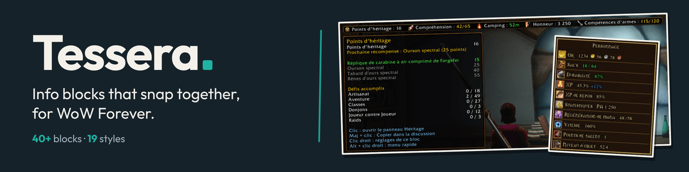
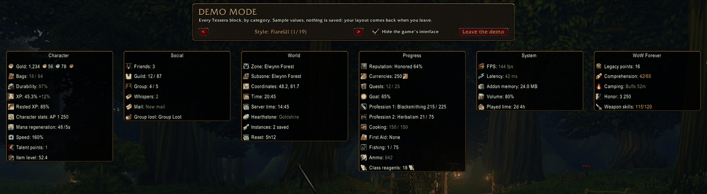
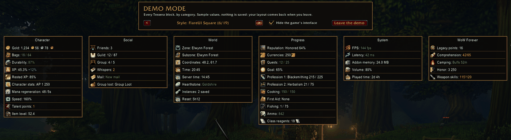
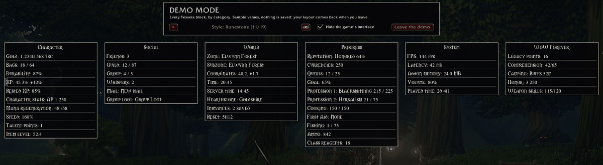
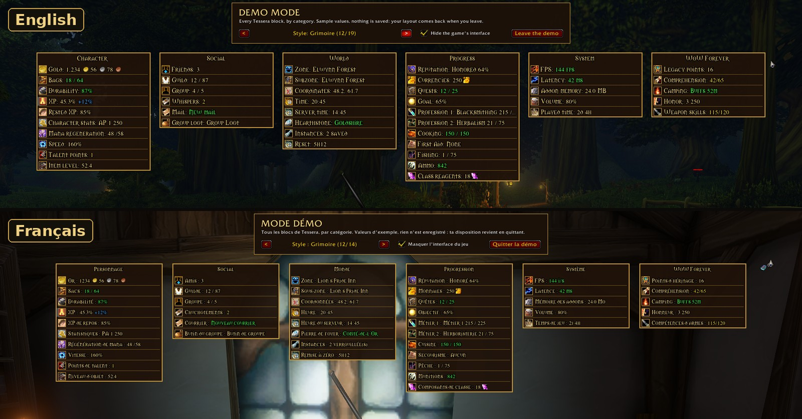

# Tessera: little info blocks you put anywhere



**Download:** [CurseForge](https://www.curseforge.com/wow/addons/tessera) · [Wago](https://addons.wago.io/addons/tessera) · [GitHub releases](https://github.com/Brainc3ll/Tessera/releases)

[](ACR.md) Written by an AI (Claude) from my ideas; I test every version in game; no human reads the code line by line.

**TL;DR:** Gold, bags, FPS, Legacy points… in small blocks that snap together like mosaic tiles. Made by a player who can't code and an AI that can't play (yet). So I test it a lot.

Tessera is a World of Warcraft addon for **WoW Forever** that shows small information blocks
(gold, bags, durability, FPS, latency, time, XP, quests...) and launcher blocks (minimap and
addon compartment buttons). Each block can be styled and placed on its own, and blocks placed
against each other **merge** into a single frame, like the tiles (*tesserae*) of a mosaic.

It only uses data provided by the game itself, and embeds no library. LibSharedMedia is used
when another addon provides it, to offer that addon's fonts, backgrounds and borders, and
LibDataBroker to exchange data with DataBroker addons.

> **Made for WoW Forever.** I build and test Tessera on WoW Forever. Its own systems
> (Legacy, camping, Comprehension, PvP) are still young and may change, so a game update can break
> a block until Tessera catches up.

## What makes it different?

- **Blocks that snap together.** Drag a block against another and they merge into one bar. Build a top bar, a column, a corner cluster, or keep each block on its own.
- **Made for WoW Forever.** Legacy points (next reward, challenges per category), Comprehension (with the scrolls in your bags), Camping (buffs and kit), Honor, weapon skills, your hunter pet's happiness, poisons and sharpening stones, Well Fed and other long buffs.
- **You pick what each block shows.** Played time this level or in total, honor out of its cap, the next Legacy reward, XP per hour or the time to your next level, the total gold of your characters, the repair cost, the parts of a tooltip: most blocks give you a choice, grouped under folding titles (Display, Tooltip).
- **Pin a tooltip, rename a block.** Keep a block's tooltip open next to it, updated every second, and give any block a name of your own.
- **A micro-menu that grows with you.** Blizzard's micro menu in one block: its tooltip lists the menus, a click opens them; a menu you have not unlocked yet stays grey until you reach it.
- **One look for everything.** Every block shares the same tooltips and the same style: Blizzard's look, Bronze and Bronze and gold (FlareUI), Elven (ElvUI), Emerald (EllesmereUI), Aurora (DaylightUI), or fantasy styles built from the game's own frames. Lock a block's style and it keeps its look when you change the profile's style or an interface goes missing.
- **In your language.** English and French from day one, plus German, Spanish and Brazilian Portuguese.
- **Looked after.** Each version is tested in game, and your layouts carry over from one version to the next.
- **Ready to stream.** Streamer mode hides other players' names, your other characters, your guild's name and your gold in one click.
- **DataBroker both ways.** Show your other addons' DataBroker objects as blocks, or share Tessera's blocks with Titan Panel, Bazooka or Arcana (formerly ChocolateBar).

## Why make Tessera when addons like it already exist?

I love bars like Arcana (formerly ChocolateBar) and Bazooka. I used Broker_Everything a lot, and I spent hours building small bars with a single piece of info each, to put them in just the right spot on my interface. My favorite was StatBlock Core by Funkeh: free-floating blocks, one per piece of info, that I could put anywhere. It hasn't been updated since 2022. And tooltips didn't look the same from one broker addon to the next, French was often missing, and many of those addons were no longer maintained.

When the WoW Forever beta came out, I came back to WoW and found FlareUI: an interface with a fantasy look, not a futuristic one. Seeing what players were building with AI's help, I wanted to try something: a small thing just for me, that did exactly what I asked for.

That's how Tessera was born. It was never meant to be published. I wanted to learn how it works when you start a GitHub repo from scratch and release an addon. Then I put it through more testing than I gave the Forever beta itself, and the ideas kept coming. Some are in Tessera today. Others are on the way (see below).

So I decided to make it available to as many players as I could. That meant watching closely what the AI does: the right WoW words in every language, and code checked with the tools real addon developers use.

## Where it is going

Plans, not promises:
- **Accessibility** for players with disabilities: Tessera follows the game's own accessibility settings and only adds what its blocks need. From 1.3, every new feature is checked with text twice as big, in high contrast and without a mouse.
- **Full gamepad support**, built on WoW Forever's own gamepad mode: something I have never seen in a panel or DataBroker addon.
- **An interface that sizes itself from its texts**, so no translation or bigger text ever overflows a button.
- **A language setting**, to use Tessera in another language than your game client.

## Screenshots

Demo mode (`/tessera demo`) shows every block at once with sample values. The same blocks in
19 of the 26 styles (screenshots from version 1.0.0). FlareUI is shown with the addon installed; without it, the
interface styles are an imitation:

**Interface and Blizzard styles**



**Square, Clean and Transparent styles**



**Fantasy styles and styles made from the game's frames**



**English and French built in**



## About this project: how Tessera is made

Tessera is a collaboration between me, a player, and an AI.

**Me (Braincell1980).** I don't write code. Life never gave me the chance to learn programming, and AI now lets me give free rein to my addon ideas. I also use the AI to learn how things work and why (GitHub, CurseForge, WoW's Lua and its interface, what a clean release looks like), so I make the decisions myself and understand what goes into each version. What I do:
- I had the idea of Tessera and I decide what it does: every feature, block, option and layout comes from my requests or got my approval.
- I choose the look: styles, colors, layouts, names, what goes in the menus.
- I test a lot, on WoW Forever: every version, with strange experiments, unusual placements and odd setups, to find the problems before you do.
- I try to think ahead, for every kind of player: other interfaces, other screens, other languages, other habits.
- I run the in-game checks (debug versions) that show how WoW Forever works, and I report bugs with screenshots.
- I review the texts, the French translation and the help.
- I decide when a version goes out, and I manage the CurseForge, Wago and GitHub pages.

**Claude (an AI by Anthropic)** writes everything else, from my instructions:
- all the code of the addon (Lua), and the automatic tests that run it outside the game;
- the English and French texts (options, tooltips, help, changelog, this page) and the German, Spanish and Brazilian Portuguese translations;
- the release tools (GitHub workflows, CurseForge upload) and the debug versions;
- the banner images.

**Thanks** to Funkeh, whose [StatBlock Core](https://www.curseforge.com/wow/addons/stat-block-core) (free-floating DataBroker blocks, no longer updated since 2022) was my first inspiration for Tessera.

**Thanks** to Malkkav, author of [FlareUI](https://www.curseforge.com/wow/addons/flareui) (MIT license): the options window takes its look from it.

**Fonts**, shipped unchanged in `Media/Fonts`, with a copy of each license in the `Licenses` folder (also in the release zip): [Atkinson Hyperlegible Next](https://github.com/googlefonts/atkinson-hyperlegible-next) (SIL Open Font License 1.1, copyright The Atkinson Hyperlegible Next Project Authors), [OpenDyslexic](https://github.com/antijingoist/opendyslexic) (SIL Open Font License 1.1, copyright Abbie Gonzalez) [Luciole](https://www.luciole-vision.com/) (CC BY 4.0, copyright Laurent Bourcellier and Jonathan Fabreguettes (Perez)), [Lexend](https://github.com/googlefonts/lexend) (SIL Open Font License 1.1, copyright 2018 The Lexend Project Authors), [Andika](https://software.sil.org/andika/) (SIL Open Font License 1.1, copyright 2004-2022 SIL International), [Inclusive Sans](https://github.com/LivKing/Inclusive-Sans) (SIL Open Font License 1.1, copyright 2022 The Inclusive Sans Project Authors), [Cinzel](https://github.com/NDISCOVER/Cinzel) (SIL Open Font License 1.1, copyright 2020 The Cinzel Project Authors) and [Inter](https://github.com/rsms/inter) (SIL Open Font License 1.1, copyright 2016 The Inter Project Authors). The About tab has a Licenses chapter with the same credits.

**What this means for you.** Automatic tests and my own testing in game check the code, but no human programmer has reviewed it line by line. Bugs can remain: please report them with `/tessera bug`. Developers are welcome to read the code (MIT license, in this repository) and to suggest improvements.

In short, Tessera's [AI Code Rating](https://aicoderating.com) is **E4d**: a maintainer who does not program, 76–100% of the code written by AI, changes tested but not read by a human (details in `ACR.md`). `AI-DECLARATION.md` gives the AI's part at each stage (design, code, tests, docs, review, release).

## How I look after it

- I play WoW Forever and test each version in game before I release it.
- Your layouts, styles and profiles carry over from one version to the next. If a change ever has to break them, Tessera warns you and converts them. Export texts from older versions still import.
- On every change, GitHub runs automatic checks: static analysis, the API audit addon reviewers use, a check against WoW Forever's own function list, a full run of the addon in English and French, and a test of the Forever blocks against a changing game.
- Compatibility with other addons goes through public standards only (DataBroker, LibDBIcon, LibSharedMedia), never through their internals, so their updates don't break Tessera.
- WoW Forever's own systems are young and may change. If a game update breaks a block, tell me and I'll fix it.
- Tessera is free and open source (MIT license): every feature for everyone, no premium version, no paid extras. You can read it, change it and share it.

I can't promise how many years I'll keep this up. Today, this is how I run it.

## At a glance

- Interface: `16001` (WoW Forever)
- Languages: English and French; German, Spanish (Spain and Mexico) and Brazilian Portuguese made by Claude, not reviewed yet. A Language list in the General tab picks the language of Tessera's texts (default: as the game; applied after a reload). Other languages welcome as a pull request or a "Translation" issue (see `docs/TRANSLATING.md`)
- Saved variables: `TesseraDB`
- Optional addons it adapts to: FlareUI, EllesmereUI, ElvUI and DaylightUI (a matching style is
  offered; blocks snap to the XP bar of FlareUI, ElvUI and GW2 UI, and Tessera warns when they
  cover frames of FlareUI, EllesmereUI, ElvUI, DaylightUI or GW2 UI), LibSharedMedia-3.0, LibDBIcon-1.0, LibDataBroker-1.1 and DataBroker
  display addons (Titan Panel, Arcana (formerly ChocolateBar), Bazooka...)

## For players

Copy the `Tessera` folder into the `Interface/AddOns/` folder of your WoW Forever
installation (or let CurseForge do it). Type `/tessera` (or `/tes`) to open the options; the
Help tab inside the game explains everything.

**Highlights**

- **Stone and metal windows (2.0):** the options window, the placement banner and Tessera's other
  windows use the game's rock and the metal frame of its dialogs, in the colors of your style;
  high contrast draws them plain black with a thick white edge.
- **Four new block styles:** Gilded, Blue rune, Silver and Brazen give your blocks a tinted,
  see-through background, a rounded edge drawn by Tessera and an ornament between merged blocks.
  Corners: rounded, or square with a line one screen pixel wide.
- **HD icons:** for every style, the game's large drawings (gamepad menus, cursors) in a round
  ring, tinted or not; blocks without one keep their icon.
- **Mosaic placement:** place blocks anywhere; dropped against each other, they merge in every
  direction: a bar, a column, a corner, an L shape... Stick a bar to a screen edge and stretch it
  over the whole width, or start from a ready-made layout (among them "Double
  bar": the top bar and a second bar always shown with the WoW Forever blocks).
- **Demo mode:** every block at once, sorted by category, with sample values; a banner switches
  the styles (or shows them side by side, one per column: "Mixed styles") and hides the game's
  interface, for screenshots. Your layout comes back afterwards.
- **Blocks made for WoW Forever's own systems**, which can also be shared with DataBroker
  display addons (Titan Panel, Arcana (formerly ChocolateBar), Bazooka...):
  - Legacy points: your available points, your points, the next reward, every reward of the track,
    the points spent in each Legacy tree and your Legacy challenges completed per category; a click
    opens the Legacy panel;
  - Comprehension: your scroll-reading skill and the scrolls in your bags; a click casts Scroll
    Comprehension;
  - Camping: time left on your camp buffs, or your campfire kit's cooldown; a click lights a
    campfire with the kit;
  - Honor: your honor points (PvP ranks in a later version);
  - skills read from Forever's skill list (the weapon in hand, the ranged one while you shoot, or
    one you pick); profession, talent and Legacy blocks that open Forever's own windows.
- More than 50 blocks in all: gold (history of 7, 14 or 30 days, your characters' gold and their total for the same faction and realm; Alt + right-click forgets a deleted character), bags (with junk value and
  profession bags), durability (with the repair cost), XP (with the time to the next level and the quests to hand in; "Reset session" is a click action on gold, XP, reputation, currencies, XP per hour and goal), FPS and latency (with graphs), local and server time, date, XP, rested XP, coordinates,
  zone and subzone, friends (notes, sorting, Battle.net friends in WoW only), guild (message of the day, ranks and public notes in the tooltip, 5 to 100 members shown, top ranks on top), group (roles, state and level in the tooltip), quests (sorted by level or finished first, with zone and a free-slot alert), reputation (points left and session gain), currencies (any currency you own, cap, session gain), goal (gold, level, items or a currency, "Reached" and the estimated time), professions (one block
  each, plus cooking, first aid and fishing), talent points, hearthstone, mail, whispers, class
  reagents (choose them, stock levels, grayed at zero), ammo, item level, speed, volume, addon memory (5 to 30 addons, share, total), instances (nearest reset first, reset alert), daily and weekly reset, played time, goal, mana
  regeneration, character stats (the stat of your choice), group loot (click: /roll), streamer mode,
  micro-menu (the menus in its tooltip, grey until unlocked), hunter pet, weapon enchant,
  long buffs, XP per hour (shares the session, last 15 minutes), gold this session, corpse...
- Streamer mode (Placement and more tab, a key binding or its block): for streams and videos, other players' names,
  your other characters, your guild's name and your gold show as `***`.
- Blocks that have nothing to show hide themselves and keep their place (in the ready-made bars,
  they sit in the second row). A group stays exactly where you drop it: no automatic recentering.
- Merge blocks in every direction; undo, alignment guides, frozen groups, spacer blocks; groups
  fused, as tiles with joints, or separate.
- Replace a block in place: the arrows on a hovered block (placement mode) put another block
  exactly there, with the same look, without moving anything else; a shown block swaps places,
  and the spacers of the ready-made layouts can be filled this way. A cross removes the block: it leaves its group and the others close the gap.
- Place to the pixel: "Place by pixel" (Blocks and groups tab or placement banner) moves a block's group one screen pixel at a time
  with the arrow keys (Shift: 10 pixels) or the arrows of the banner, or to the X and Y you type;
  click another block to place it instead; Enter (or "Keep") keeps the place, Escape puts the groups back.
- Groups: each bar of merged blocks has its entry in the Blocks and groups tab, so its settings apply to the
  whole bar and its rows; "Copy style to group" (options or quick menu) gives one block's look to
  the rest of its group.
- Per-block style, icons (same size, square or round frame, black and white), opacity, scale,
  progress bar, thresholds, show on hover, alerts, click actions, and how the value is shown
  (gold format, coin icons, rounding; bag slots; XP; durability; latency; seconds; decimals...).
- DataBroker tab: other addons' DataBroker objects as blocks ("Plugins as blocks"); Tessera's
  blocks shared with Titan Panel, Arcana (formerly ChocolateBar), Bazooka... ("Sharing and mode"); a DataBroker mode,
  on automatically when such an addon is installed (Tessera then shows nothing itself), that can
  be turned off to use both. With DaylightUI installed, a note explains how to show Tessera's blocks in its panels.
- First launch next to another interface: Tessera's welcome, news, DataBroker notice and style offer wait for that interface's setup guide or tour (DaylightUI, FlareUI, ElvUI, EllesmereUI, GW2 UI) to close.
- Style and layouts tab: styles, how groups look, screen edges, ready-made layouts, blocks in front of or behind
  Blizzard's frames, and sharing, in one place, with shortcuts to the frame and text of all blocks.
- Round minimap button (click: options, right-click: lock / unlock, drag it around the minimap);
  with FlareUI, Tessera is in FlareUI's addon bag instead.
- 31 styles: four new styles (Gilded, Blue rune, Silver, Brazen: rounded edge drawn by Tessera, ornaments between merged blocks), matching FlareUI (Bronze, Bronze and gold), ElvUI (Elven), EllesmereUI (Emerald), DaylightUI (Aurora: with the addon, its own API draws the frame of each block) (also without those addons, as an imitation) or
  Blizzard's look (Blizzard Retail in silver, Blizzard Forever in gold, Blizzard Classic), Square
  styles, Clean, Transparent, fantasy styles (Runestone: text only, black and white; Grimoire;
  Parchment; Arcane), styles made of the game's own frames (Royal seal, Ironforge, Runeblade,
  Ember, Sylvan), The War Within and Midnight (Blizzard's frames of these expansions on the options
  window) and Tessera, in the addon's own colors.
- Profiles with export/import, ready-made layouts and an automatic dungeon/raid profile.
- Accessibility tab: bright or soft colors for values and class colors, or colorblind values;
  high contrast; fewer animations; the shadow under Tessera's windows (on or off); minimum text size; the font of all blocks (the same setting as in the Blocks and groups tab). Class color on the text, background,
  border, icon frame and lines.
- Fonts for easier reading, in every font menu: Atkinson Hyperlegible Next and Luciole (low vision), OpenDyslexic
  (dyslexia), Lexend (reading flow), Andika (beginning readers) and Inclusive Sans (general legibility), each in regular and bold. The menu shows in grey which alphabets each one covers. Other addons that
  use LibSharedMedia can pick them too.
- Share only a style or only a layout as text; the import lists what is missing on your computer
  (other addons' blocks, media, WoW Forever blocks) before applying anything.
- Tooltips your way: bigger or smaller, with or without blank lines between their parts, or only while holding Alt (Placement and more tab).
- A quick tour on first launch (again from the Help tab), where the ready-made layouts can be
  tried one after the other right on the screen, a demo mode showing every block by category
  with sample values and a style switcher.
- In front of or behind Blizzard's frames: Tessera never moves them. When blocks cover some of them
  (action bars, minimap, buffs), you choose whether the blocks stay in front or behind; placement
  mode (and Blizzard's Edit Mode) can switch every block for a while to see what is underneath.

### The blocks, one by one

Every block has a tooltip (hover it), a click (below), **Shift + click** to copy its value to the
chat and a **right-click** for its own settings. Blocks marked *(shown at first)* are on screen
after a first install (the Essentials layout); add the others from the list at the top of the
Blocks and groups tab, then turn on "Enabled".

**Character**

| Block | What it shows | Click |
|---|---|---|
| Gold *(shown at first)* | Your gold; tooltip: session gain, history of 7, 14 or 30 days, your characters' gold and their total | Open your bags |
| Bags *(shown at first)* | Free (or used) bag slots; tooltip: junk value, profession bags apart | Open your bags |
| Durability *(shown at first)* | Your lowest durability; tooltip: each item and the repair cost (worn items and damaged ones in the bags) | Character sheet |
| XP | XP to the next level; tooltip: rested XP, time to level, quests to hand in | |
| Rested XP | Your rested XP | |
| Item level | Equipped item level, best available, or both; weakest items first in the tooltip | Character sheet |
| Character stats | The stat of your choice, and a second one | Character sheet |
| Mana regeneration | Your mana per 5 seconds | Character sheet |
| Talents *(shown at first)* | Unspent points, points per tree, main tree or active spec; the tooltip adds your specs and the next milestone | Open the talents; middle click changes spec |
| Hunter pet | Your pet's happiness | |
| Weapon enchant | Time left on your poison or sharpening stone | |
| Long buffs | Your long buffs and the time left on them | |
| Corpse | Distance and direction to your body after a death | A map pin on your body |

**Social**

| Block | What it shows | Click |
|---|---|---|
| Friends *(shown at first)* | Friends online, colored by your status. Hover: a clickable list of your WoW and Battle.net friends online (click to whisper, right-click to invite, Shift + click for a menu, search) | Friends list |
| Guild *(shown at first)* | Members online (and the guild name if you want). Hover: a clickable list with rank, public note, message of the day and search, same clicks as Friends | Guild window |
| Group | Your party or raid. Hover: a clickable list with roles and state, a raid sorted by group | |
| Whispers *(shown at first)* | Unread whispers, or the last sender. Hover: your last 5, 10 or 20 whispers, kept after a reload; click to reply, the star pins one, the cross deletes it, Clear removes the rest | Reply to the last one |
| Mail | Mail waiting for you | |
| Group loot | The loot method of your group | /roll (1-100) |

**World**

| Block | What it shows | Click |
|---|---|---|
| Time | Local time | Calendar |
| Server time | The realm's time | Calendar |
| Date | Today's date | Calendar |
| Coordinates | Your position on the map | World map |
| Zone, Subzone | Where you are | World map |
| Hearthstone | Its bind location and cooldown | Use the Hearthstone |
| Instances | Your saved instances, nearest reset first, with an alert | |
| Daily and weekly reset | Time to the next resets | |

**Progress**

| Block | What it shows | Click |
|---|---|---|
| Reputation | Your watched reputation, points left, session gain | Open reputations |
| Currencies | Any currency you own, its cap and session gain | Open currencies |
| Quests | Quests in your log, sorted by level or finished first, with a free-slot alert | Open the quest log |
| Goal | Gold, a level, a currency, or up to 3 items to collect; "Reached" and the time left at your pace | Add, change or remove an item (or drop an item from your bags on it) |
| Professions | One block per profession, plus Cooking, First Aid and Fishing | Open the profession |
| Class reagents | Your reagents, grayed at zero | |
| Ammo | Ammo left | |
| XP per hour | Your XP rate this session (or the time to level at that pace) | |
| Gold this session | Gold earned or spent since you logged in | |

**System**

| Block | What it shows | Click |
|---|---|---|
| FPS *(shown at first)* | Frames per second, with a graph | |
| Latency | Home and world latency, with a graph | |
| Addon memory | Memory of your addons (5 to 30 listed) | |
| Volume | Master volume | Mute or unmute; wheel: volume; clickable list of channels, output device and up to four named presets (Hover shows: List); the block can show the preset name |
| Played time *(shown at first)* | This level, total or this session | |
| Streamer mode | Whether it is on; its settings choose what it hides (other players, your characters, guild name, gold) | Turn it on or off |
| Micro-menu | Blizzard's micro menu in one block; the menus in its tooltip | The menu list |

**WoW Forever**

| Block | What it shows | Click |
|---|---|---|
| Legacy points | Your available points, your points, the next reward, the whole track, the points per tree and your challenges | Open the Legacy panel |
| Comprehension | Your scroll-reading skill and the scrolls in your bags | Cast Scroll Comprehension |
| Camping | Time left on your camp buffs, or the kit's cooldown | Light a campfire with the kit |
| Honor | Your honor points | |
| Skills | The skill of the weapon in hand (or one you pick) | Open the skills |

**Not data blocks**

- **Launchers:** any minimap button of another addon becomes a block you place anywhere
  (Launchers tab).
- **DataBroker blocks:** other addons' DataBroker objects shown as blocks (DataBroker tab).
- **Spacers:** empty blocks to leave room in a bar.

| Command | Effect |
|---|---|
| `/tessera` | Open or close the options |
| `/tessera lock`, `/tessera unlock` | Lock the blocks, or unlock them to move them |
| `/tessera reset` | Reset everything: empties the saved variables, then reloads the interface |
| `/tessera minimap` | Show or hide the minimap button |
| `/tessera preview` | Sample values in every block (for screenshots) |
| `/tessera demo` | Demo mode: every block by category, sample values, style switcher (again to leave) |
| `/tessera bug` | Report to copy into a bug report |
| `/tessera broker` | DataBroker mode on or off |
| `/tessera recover` | Bring back blocks that stick out of the screen |
| `/tessera help` | The list of commands in the chat |

Key bindings (show / hide all blocks, lock / unlock, options, streamer mode on / off) are in the game's key bindings,
Tessera category.

When unlocked: drag a block to move it (or its whole group), drop it against another block to
merge them, **Shift + drag** to detach it, the **cross** on a hovered block (or **Ctrl + click**)
to remove it, its **arrows** to replace it with another block, **Ctrl + Z** to undo, **right-click**
for the quick menu; a panel under the placement banner shows what you can do with the hovered
block. When locked: hover for the tooltip, left-click to open
the related game window, **Shift + click** to copy the value to the chat, right-click for the
block's settings, **Alt + right-click** for the quick menu.

**Reporting a bug:** type `/tessera bug`, copy the report from the window that opens and paste it
into a new issue (a template is provided), or in the comments of the
[CurseForge page](https://www.curseforge.com/wow/addons/tessera).

### Memory, FPS and refresh rates

An addon manager counts live data plus garbage that Lua has not collected yet. Tessera makes garbage when it
rebuilds blocks (a style change, a move, a merge) or draws the options window; the collector clears it in the
background, so the figure rises and falls. The game never frees a frame an addon has created, so the options
window and every block you have shown stay allocated until you reload. The figure depends on your blocks, your
DataBroker sources and your other addons. Memory use does not lower the frame rate by itself: what you feel are
pauses when a lot of garbage is collected at once. With the blocks locked, Tessera does little work; to lighten
it further, hide the blocks that update often (coordinates, speed).

One timer wakes each shown block at its own pace:

| Rate | Blocks |
|---|---|
| 4 times a second | Coordinates |
| 2 times a second | Corpse, Speed |
| Every second | Camping, FPS, Hearthstone, Server time, Time |
| Every 2 s | Regeneration, Stats |
| Every 5 s | Latency, Long buffs, Volume, Weapon enchant |
| Every 10 s | Pet |
| Every 15 s | XP rate |
| Every 30 s | Date, Mail, Memory, Played, Reset |
| Every minute | Honor, Legacy |
| On a game event only | the 27 other blocks |

Blocks that forward another addon (DataBroker, launchers) update every 2 s. Hidden blocks do not update.

## For developers

The code is plain Lua with no build step and no embedded libraries. Every file starts with a
header explaining its role, and the tricky parts (secure clicks, secret values, border seams)
are commented in place. Start with the headers of `Core/Core.lua`, `Blocks/Modules.lua` and `Core/Merge.lua`. Lua refuses a file with more than 200 local variables alive at once: `tools/check_locals.py` keeps every file under 160, so a big file is split before it gets there.

### Files (in load order, see `Tessera.toc`)
The Lua files sit in folders: `Core/` (engine, styles, placement, profiles), `Blocks/` (the data blocks and their tools), `Lists/` (the lists shown under the mouse), `Options/` (the options window) and `Extras/` (changelog, demo mode, DataBroker). `Locales/`, `Media/` and `Licenses/` keep their place; `Tessera.toc` and `Bindings.xml` stay at the root (the game reads them there).

| File | Role |
|---|---|
| `Locales/enUS.lua` | English strings: the base table `ns.L`. Every key must exist here. |
| `Locales/Language.lua` | The language in use: `ns.RegisterLocale` (each language file hands its texts to it), the saved choice (`ns:ApplySavedLanguage`, read when the saved variables exist), `ns.OnLanguage` for texts read while the files load. |
| `Locales/frFR.lua` | French strings, override `ns.L` keys when the language is French. |
| `Locales/deDE.lua`, `esES.lua`, `esMX.lua`, `ptBR.lua`... | The other languages, sent by pull request or issue; a missing text shows in English. |
| `Core/Core.lua` | Shared namespace, frames of known interface addons (`ns.KNOWN_UI_FRAMES`), media lists, frame skinning, saved variables and profiles, block creation/styling/visibility/updates, mouse handlers, snapping, default layout, events, the shared update timer, slash commands, minimap button. |
| `Core/Themes.lua` | The styles (Bronze, Bronze and gold and Bronze (old) for FlareUI, Emerald for EllesmereUI, Elven for ElvUI, Aurora for DaylightUI, Blizzard Retail/classic, Square styles, Clean, Transparent, fantasy styles, styles made of the game's frames, Gilded, Blue rune, Silver and Brazen), the style offered when an interface is installed. |
| `Core/Looks.lua` | HD icons (`ns.HD_ICONS`, ring and disc); the frame of Gilded, Blue rune, Silver and Brazen: rounded fill and edge in 9 pieces from `Media/Looks` (made by `tools/gen_looks_media.py`), squared at the joins of fused groups; ornate separators. |
| `Core/Merge.lua` | Docking blocks into groups, group layout (sizes, equal heights/widths, shared widths, second row placed once, hidden blocks keeping their place), unlock-mode name tags, border seams and corner joins. |
| `Core/Placement.lua` | Coordinates and scale, relative positions, undo, alignment guides, snapping to Blizzard frames, frozen groups, quick menu, click actions, key bindings. |
| `Core/Layers.lua` | Blocks in front of or behind Blizzard's frames: which frames the blocks cover, the question when locking, the temporary switch of placement mode; Edit Mode copies left by older test versions (back to the player's layout, cleanup). |
| `Core/Profiles.lua` | Profile export / import (compact text; older texts still read), style and layout sharing with the check of what is missing, duplicate, automatic dungeon / raid profile. |
| `Core/SecureClicks.lua` | Invisible secure buttons over blocks, so clicks open Blizzard windows without tainting them. |
| `Extras/Changelog.lua` | Version history for the in-game About tab (What's new topic: each entry's `highlights`, one short line per new thing with an optional `show` target; Changelog topic), sorted by kind since 1.0.0 (new, improvements, fixes), in English and French only (`lua5.1 tools/changelog_md.lua > CHANGELOG.md` regenerates `CHANGELOG.md`). |
| `Blocks/Modules.lua` | Tools shared by the data blocks (thresholds, durations, money, item counts; `ns.BlockTools`), the order of the blocks (`ns.MODULE_ORDER`) and the guide to adding a block. |
| `Blocks/TraitsData.lua` | Reads the talent tree and the Legacy trees (points, trees, specs) for the Talents and Legacy blocks. |
| `Blocks/ModulesCharacter.lua` | Data blocks about your character: gold, bags, durability, experience, rested, stats, regeneration, speed, talents, item level, pet, buffs, corpse. **Add a block in the file of its category.** |
| `Blocks/ModulesSocial.lua` | Data blocks about other players: friends, guild, group, whispers, mail, loot. |
| `Lists/WhisperList.lua` | The Whispers block's history, shown under the mouse in place of the tooltip: the last players who whispered you, a click replies. |
| `Lists/FriendsList.lua` | The Friends block's list (WoW and Battle.net friends online), shown under the mouse in place of the tooltip: search, scrolling, whisper and invite. |
| `Lists/GroupList.lua` | The Group block's list (party or raid members), shown under the mouse in place of the tooltip: search, scrolling, whisper. |
| `Lists/GuildList.lua` | The Guild block's member list, shown under the mouse in place of the tooltip: search, scrolling, whisper and invite. |
| `Lists/VolumeList.lua` | The Volume block's list, shown under the mouse in place of the tooltip: every sound channel, mute, and up to four named presets. |
| `Blocks/ModulesWorld.lua` | Data blocks about the world: zone, subzone, coordinates, clocks, date, hearthstone, instances, reset. |
| `Blocks/ModulesProgress.lua` | Data blocks about progress: reputation, currencies, quests, goal, professions, ammo, reagents, experience rate, gold gained. |
| `Blocks/ModulesSystem.lua` | Data blocks about the computer and the game: FPS, latency, memory, volume, time played, streamer mode. |
| `Blocks/ModulesForever.lua` | Data blocks for WoW Forever only: Legacy, Comprehension, Camping, Honor, weapon skills. |
| `Blocks/MicroMenu.lua` | Micro-menu block: Blizzard's micro menu in a tooltip and a list of secure buttons that open each menu. |
| `Blocks/Pins.lua` | Pinned tooltips: a block's tooltip kept open next to it and refreshed every second. |
| `Blocks/Launchers.lua` | Launcher blocks built from minimap buttons, LibDBIcon buttons and addon compartment entries. |
| `Blocks/Spacers.lua` | Spacer blocks (empty, separator line or text). |
| `Extras/Demo.lua` | Demo mode: every block by category with sample values, style switcher (also mixed styles, one per column), the player's profile put aside and given back. |
| `Extras/Broker.lua` | DataBroker: other addons' data objects as blocks, Tessera's blocks published as data objects, DataBroker mode. |
| `Bindings.xml` | Key bindings (loaded automatically by the game, not listed in the TOC). |
| `Options/Options.lua` | Options window, first part: constants, the selection (all blocks, launchers, a group or one block), placing newly shown blocks and the state shared by the `Options*.lua` files (`ns.OptionsTools`). Together the nine `Options*.lua` files are the options window. Pages in a list on the left: Blocks (the "On screen" switch and the block list, then three tabs: Content, Appearance, Behaviour), Look, General, Accessibility, Launchers, DataBroker (Plugins as blocks, Sharing and mode, as two tabs), Profiles, Help, About. Since 1.5 every page sits in boxes (`Options/OptionsBoxes.lua`, after FlareUI's settings panel): one setting per row (label on the left, control on the right), two short ones per line; `ns.optionRows` lists every row with its page, tab and box, for the search, the help panel and the gamepad. The top bar holds the logo, the search and the fold button; the help panel sits on the right; Shift + mouse wheel sizes every Tessera window and its help tooltips (the percentage shows at the top). Also here: the placement banner, the text window (export / import / bug report) with a copy box for the About links, the welcome popup and quick tour, side windows kept beside the options (never over them), and the Blizzard Settings page. |
| `Options/OptionsSkin.lua` | The 2.0 "stone and metal" skin of Tessera's windows (`ns.Skin`): colors of each style, the rock and metal frame, boxes, the light behind list lines; plain in high contrast. Its white drawings are in `Media/Skin`, made by `tools/gen_skin_media.py` (icons at 128 px). The logo `Media/Icon.png` (256 px) is redrawn from `tools/logo-source-128.png` by `tools/gen_logo.py`. |
| `Options/OptionsWidgets.lua` | The widget factory (rows, checkbox, slider, dropdown, color, edit box, button) and the small stack that places the head of the Blocks and groups tab. Every widget has a `Refresh()` method and is registered so `ns:RefreshOptions()` can update them all. |
| `Options/OptionsBoxes.lua` | Pages laid out in boxes, as in FlareUI's settings panel (1.5): each section in its own box with a Reset button, two short settings per line, indented settings that grey out under the one they depend on, only the shown rows placed; tabs at the top of a page; the keyboard order of the rows. |
| `Options/OptionsBlocks.lua` | The Blocks and groups tab: its head, its three tabs (Content, Appearance, Behaviour), the options of the selection and of every block, style targets. |
| `Options/OptionsBlockPicker.lua` | The "See all" window of the Blocks tab: every block at once (green dot on the ones on screen), search, a click selects. |
| `Options/OptionsPages.lua` | The Style and layouts, Placement and more, Accessibility, Launchers, DataBroker and Profiles and sharing tabs, with their popups (new profile, import, preset, reset). |
| `Options/OptionsHelp.lua` | Themed windows (`ns:SkinWindow`), the help text (`ns.HelpText`) and the Help and About tabs. |
| `Options/OptionsWindow.lua` | Side windows, folding and zoom, the search box, the main window (`BuildPanel`), open / toggle functions and the Blizzard settings page. |
| `Options/OptionsPlacement.lua` | The placement banner shown while blocks are unlocked and the nudge pad (move a block by the pixel). |
| `Options/OptionsTour.lua` | Welcome, quick tour, news, style offer, the text window and the bug report. |

The `docs/` folder (not shipped in the addon) is mapped in `docs/README.md`: the release guide
(`docs/RELEASE.md`), the project status and ideas (in French), the CurseForge and Wago descriptions
(`docs/pages`), studies (`docs/etudes`), finished plans and the dated project history (`docs/archive`), the English and French strings
for translators (`docs/localization`, how to translate: `docs/TRANSLATING.md`), the logo and the name in large sizes (`docs/art`), and the
banner and screenshots used on this page (`docs/media`). `CLAUDE.md` holds the working rules of the project. `ACR.md` and `AI-DECLARATION.md` describe how AI is used in the project.

Automatic tests: `lua5.1 tools/mock_run.lua . enUS` (or `frFR`, `frFR broker`) loads the addon
with a small imitation of the game API and runs every page and feature (texts exported by earlier
versions, kept in `tools/fixtures/`, must still import); lint with `luacheck .`;
`lua5.1 tools/fuzz_blocks.lua .` checks that the blocks built on WoW Forever's own systems survive
missing or changed game functions; `lua5.1 tools/check_docs.lua .` checks that the documentation
follows the code; `tools/api_audit.py` audits the code against the WoW API like addon reviewers
do. All of them run on every push (`.github/workflows/checks.yml`).

### How a value gets on screen

1. `Blocks/ModulesCharacter.lua` and the other `Modules*.lua` files register each block with `ns:RegisterModule(key, def)`.
2. At login, `Core/Core.lua` loads the profile from `TesseraDB`, creates one frame per block and
   applies its style (`ns:ApplyStyle`), position and docking (`Core/Merge.lua`).
3. A block is refreshed by `ns:UpdateBlock(key)` when one of its `events` fires, or by the
   shared timer every `interval` seconds while it is shown.
4. `UpdateBlock` calls the module's `update(cfg)`, which returns a text and an optional level
   (1 good, 2 warning, 3 bad). Core colors it, adds the label and icon if enabled, and asks
   for a layout pass when the text size changes.
5. The layout pass (`ns:UpdateLayout` in `Core/Merge.lua`) sizes every block to its text, equalizes
   merged groups, keeps second rows flush with their bar and redraws the borders where blocks touch.

### Adding a data block

Open `Blocks/Modules.lua`: its header documents every field a block can define, with a minimal
example. Put the block in the `Modules*.lua` file of its category (the same categories as the
demo) and take the shared tools it needs from `ns.BlockTools` at the top of that file. In short:

```lua
ns:RegisterModule("level", {
    label = "LEVEL",                          -- display name = L.LEVEL
    icon = "Interface\\Icons\\INV_Misc_Note_01",
    events = { "PLAYER_LEVEL_UP" },           -- or interval = seconds
    defaultEnabled = false,                   -- hidden until the player enables it
    update = function(cfg)
        return tostring(UnitLevel("player")), 1
    end,
    tooltip = function(tt, cfg)
        tt:AddLine("Some detail", 1, 1, 1)
    end,
})
```

Then add `LEVEL = "Level"` to `Locales/enUS.lua` and `L.LEVEL = "Niveau"` to
`Locales/frFR.lua`. A text read while the files load (a table at the top of a file, a popup)
stays in the language of the game: read it later, or put the definition in `ns.OnLanguage(function() ... end)`;
`ns.LocalizeList` fills `name` or `clickHint` from a key (`nameKey`, `clickHintKey`).
`TESSERA_EARLY=1 lua5.1 tools/mock_run.lua . enUS` lists such reads. Never rename a block key once released: it is stored in players' saved
variables. The block appears automatically in the options.

To open a Blizzard window on click, use `secureMacro` (a macro run by a secure button) rather
than calling the function from Lua: on this client, opening UI panels from addon code taints
them.

### DataBroker

`Extras/Broker.lua` explains it in its header. In short: blocks under keys `broker:<object name>` show
another addon's data object (looked up by name each time, so a disabled addon only hides the
block); every data block with `brokerShare` is published as `Tessera_<block key>` while sharing
is on; DataBroker mode (`ns.brokerModeActive`) hides all of Tessera's frames. A module needs
nothing special to be shared: its `update`, `tooltip` and `onClick` are reused. Blocks that open
Blizzard windows through `secureMacro` cannot do so from another addon's bar.

### WoW Forever specifics

- **Character names:** WoW Forever names characters "First name Surname", unique in the whole
  region (`RegionalUniqueNamesEnabled`, read through `_G`). Tessera keys a character's saved data
  (gold, per-character profile) by that full name alone, as AceDB does (`ns.CharacterKey`).
  `GetRealmName()` is not used on WoW Forever: it returns a ruleset label ("Classic Beta PvE")
  that may change. At login, data saved under older keys ("Name-Realm", and "Full name-<label>"
  from the 1.0.0-rc versions) moves to the full name once (`ns:MigrateCharacterKey`,
  `ns:MigrateFullNameKeys`); `tools/fixtures/sv-rc9-forever.lua` tests it on every push.

WoW Forever runs on the modern client (Midnight-era API) but has systems of its own. Blizzard
publishes no documentation for them, but the community now does: Blizzard's interface code
for Forever ([Gethe/wow-ui-source](https://github.com/Gethe/wow-ui-source), branch `forever`),
the client's function, event and image lists
([Ketho/BlizzardInterfaceResources](https://github.com/Ketho/BlizzardInterfaceResources),
branch `forever`), an API reference built from the client
([Atraeau/WoW-Addons](https://atraeau.github.io/WoW-Addons/)) and the notes pinned on the
WoWUIDev Discord. What Tessera found, with those sources and the development probes below:

- **Legacy points** (`legacy` block, `Blocks/ModulesForever.lua`): the "Legacy" reward track is a renown track
  of Blizzard's major factions system, faction ID `2802`. The points are
  `C_MajorFactions.GetMajorFactionData(2802).renownLevel`; the reward levels come from
  `C_MajorFactions.GetRenownLevels(2802)` and each reward from
  `C_MajorFactions.GetRenownRewardsForLevel(2802, level)` (its `name`, else its
  `toastDescription`, else the item's name). Updated on `MAJOR_FACTION_RENOWN_LEVEL_CHANGED`
  and every minute. The block is registered only when `ToggleLegacySystemUI` (or
  `LegacySystemFrame_LoadUI`) exists. **Legacy challenges are achievements**: the achievement
  categories are the challenge categories (Classes, Crafting, PvP, Dungeons, Raids, Adventure,
  with sub-categories); the tooltip adds up `GetCategoryNumAchievements` per main category
  (parent `-1`). **Available points and trees** (`Blocks/TraitsData.lua`): the Legacy tree is the trait
  config of type Generic (`C_Traits.GetConfigsByType`), trees 1187 (professions), 1188 (adventure) and
  1189 (progression), one shared currency (4225: quantity = available points, spent). Points per tree
  are the ranks of its nodes (`GetTreeNodes`, `GetNodeInfo`). Not found yet as an API: the "Legacy
  points: 1/65" total of the Legacy panel
  (`ChallengesPage.LegacyChallengePointSummary.PointsBar`, `TreePage.LegacyTreePointSummary`).
- **Talents** (`talents` block, `Blocks/ModulesCharacter.lua`): one trait tree of the active config
  (`C_ClassTalents.GetActiveConfigID`), currency 3820. The three trees come from the node groups
  (`C_Traits.GetGroupDisplayInfoByTreeID`), else from the X position of the nodes. Change spec: the
  secure overlay casts spell 63645 / 63644 (Activate Primary / Secondary Spec) out of combat
  (`secureExtra` in `Core/SecureClicks.lua`).
- **Comprehension** (`comprehension` block): a secondary skill, `skillID` `3012` in
  `C_SkillInfo` (category `9`, learned from level 6); its spell is `1296017`. Scrolls in the
  bags are consumables of subclass `4`, or items whose name holds the localized word "scroll"
  (weapon imbue scrolls are item enhancements).
- **Camping** (`camping` block): camp buffs are player auras: `1229741` (camp perks, 1 hour),
  `1229739` (welcoming campfire: sit 1 minute to get the buffs) and `1283391` (nearby
  campfire). The basic campfire kit is item `279981`; its cooldown comes from
  `C_Container.GetItemCooldown`, and the block's click is `/use item:279981`.
- **Honor** (`honor` block): currency `1792` in `C_CurrencyInfo.GetCurrencyInfo` (25,000 max).
  The classic rank functions (`UnitPVPRank`, `GetPVPRankInfo`) do not exist; the new rank system
  still has to be found once characters can earn ranks.
- **Weapon skills** (`weaponSkills` block): the classic globals `GetNumSkillLines` /
  `GetSkillLineInfo` do not exist; `C_SkillInfo.GetNumSkillLines()` and
  `C_SkillInfo.GetSkillLineInfo(i)` do, and return one table per line (`name`, `rank`,
  `maxRank`, `isHeader`, `isAbandonable`, `skillLineCategoryID`, `skillID`). Weapon skills are the
  lines of category `6` (defense, `skillID` 95, is listed with them). The skills window is
  `SkillsFrame`, a tab of the character window.
- **Opening windows**: Forever has micro buttons that retail removed or merged:
  `ProfessionMicroButton` (professions book, used for gathering professions, which have no
  crafting window), `TalentMicroButton`, `LegacyMicroButton`, `SpellbookMicroButton`. Blocks
  click them with a `/click` macro on their secure overlay (`MicroButtonMacro` in
  `Blocks/Modules.lua`), so the panels open from Blizzard's own code, without taint.
- All IDs above were found on the beta (October 2026) and may change.
- **Development probes** live in the test builds only (see "Test builds" below): they list
  what the client offers (API namespaces and functions, the Legacy panel's fields and texts,
  the raw skill list) in a window that can be copied, to adapt a block when Forever changes.

### WoW-specific constraints to keep in mind

- **Taint and secret values.** This client uses the Midnight-era API, where some values are
  "secret" and comparing them from addon code raises an error. Values that may be secret are
  read inside `pcall`. Blizzard panels are opened through secure macro buttons
  (`Core/SecureClicks.lua`).
- **Combat lockdown.** Secure buttons cannot be created, moved or hidden in combat; they are
  positioned in screen coordinates and re-synced after combat.
- **Forever-only functions.** The code uses the modern `C_*` API of this client. Functions that
  only exist on WoW Forever, and other addons' globals, are read through `_G["Name"]` and called
  in `pcall`: if the game removes or changes one, the block shows nothing instead of an error
  (`tools/fuzz_blocks.lua` checks it).
- **Blizzard's code stays untouched.** Tessera never replaces a Blizzard function or moves a
  Blizzard frame: replacing one taints the interface and can break it in combat. To react to the
  game, it listens to events (or, if ever needed, `hooksecurefunc`, which runs after Blizzard's
  function without replacing it). Blizzard's own interface code for WoW Forever is mirrored in
  [Gethe/wow-ui-source](https://github.com/Gethe/wow-ui-source), branch `forever` (named
  "Camelot" in that code).

### Saved variables

`TesseraDB` holds the profiles (`profiles[name]`, see `PROFILE_DEFAULTS` in `Core/Core.lua`), the
profile mode (`useGlobal`, `globalProfile`, `charProfiles`), each character's gold (`chars`),
and a few account-wide options. Each profile stores its general settings and one table per
block in `blocks[key]` (see `BLOCK_DEFAULTS` in `Core/Core.lua`).

### Translations

`Locales/enUS.lua` defines every key; every other language only overrides keys and falls
back to English for anything missing.

- English and French are written in the repository (`enUS.lua`, `frFR.lua`). Every other
  language also lives here, in its own file (`Locales/deDE.lua`...), sent as a GitHub pull
  request or pasted in a "Translation" issue (`docs/TRANSLATING.md`). German, Spanish (Spain and
  Mexico) and Brazilian Portuguese started from Claude's translations, checked with
  `tools/check_translation.py`. Up to 1.0.4 they came from CurseForge's localization tool;
  since 1.1.0 nothing is fetched from there.
- **Small keys, easy to translate.** Changing a text means every translator redoes that whole
  text. So long texts are split: the in-game help has one key per line or
  paragraph (`HELP_<TOPIC>_<n>`, topic titles `HELP_T_<TOPIC>`), and their order is given by
  `ns.HELP_LAYOUT` / `ns.HELP_LAYOUT_BROKER` at the end of `Locales/enUS.lua`. To add a line,
  create a **new** key (next free number of its topic) and put it where it belongs in the layout;
  to change a line, keep its key. Never renumber, rename or reuse a key (this also goes for the
  numbered quick tour steps, `TUTORIAL_<n>`). `tools/check_docs.lua` refuses any text longer
  than 600 characters.
- The English and French texts are written in `tools/gen/*.py`; `python3 tools/gen/build.py`
  writes `Locales/enUS.lua` and `Locales/frFR.lua` from them (it checks that every key has its
  French text and the same `%s` / `%d`).
- `docs/localization/` holds the English and French strings, one per line, for translators
  (regenerate with `lua5.1 tools/export_locales.lua . enUS docs/localization/enUS.lua`, same
  for `frFR`); `tools/check_translation.py` compares a translation with them.

### Releasing

One workflow publishes everywhere: **Package and release** (`.github/workflows/release.yml`,
"Run workflow" in the Actions tab). It checks the documentation, tags the version written in
`Tessera.toc`, builds the zip with the BigWigs packager and
uploads it to GitHub, CurseForge and Wago. Details (in French) in `docs/RELEASE.md`.

### Checking your changes

```sh
luacheck .                       # static checks (uses the provided .luacheckrc)
lua5.1 tools/mock_run.lua .      # loads the addon in a rough WoW API mock, prints Lua errors
lua5.1 tools/fuzz_blocks.lua .   # WoW Forever's blocks survive missing or changed game functions
lua5.1 tools/check_docs.lua .    # README, help, descriptions, changelog, strings: up to date?
python3 tools/api_audit.py <lua-language-server> <vscode-wow-api folder>
python3 tools/forever_api_check.py <BlizzardInterfaceResources folder, branch forever>
forever-lint --fail-on warning .  # pip install forever-lint: what Forever changed for addons
```

`forever-lint` ([JoseArgento/forever-lint](https://github.com/JoseArgento/forever-lint), MIT) knows
Forever's own rules: functions that only survive as Blizzard's deprecated fallbacks, values that
can be secret, events that no longer fire, TOC versions. GitHub runs it on every push.

`tools/api_audit.py` runs the audit addon reviewers use: the Lua Language Server with Ketho's
WoW API annotations ([vscode-wow-api](https://github.com/Ketho/vscode-wow-api)). It fails on
unknown globals and deprecated functions. Functions that only exist on WoW Forever (not in
Blizzard's documentation of the modern API) and other addons' globals are read through
`_G["Name"]`, which tells readers they may be missing.

`tools/forever_api_check.py` compares every `C_Namespace.Function` call with the function list
of the WoW Forever client itself, from the `forever` branch of Ketho's
[BlizzardInterfaceResources](https://github.com/Ketho/BlizzardInterfaceResources) (it also lists
the client's CVars and events). A call the client lacks fails the check, unless a fallback takes
over on the same line.

`tools/check_docs.lua` checks that the version is the same everywhere, that `CHANGELOG.md` and
`docs/localization/` match the code, and that every public command, block, Lua file and option
tab appears in the README, the in-game help and the CurseForge / Wago descriptions. A release
stops if it fails.

The mock only catches Lua errors (nil calls, typos, load order); it does not replace testing
in game.

### Test builds

Released versions have no command a player does not need. The test builds given to the
author for his test sessions add one extra file (`TesseraDev.lua`, kept out of this repository
and never packaged) at the end of `Tessera.toc`: `/tessera test` (blocks to check, layouts for
the name tags, tooltip settings, back to the player's profile) and the development commands
(debug report, WoW Forever probes, shape test). `Core/Core.lua` only calls
`ns.DevCommand` when that file is there; the mock loads it with `TESSERA_DEV=<path>`.

## License

MIT, see `LICENSE`. The `Licenses` folder, shipped in the zip, holds a copy of it and the licenses of the six fonts (see its `README.txt`).
