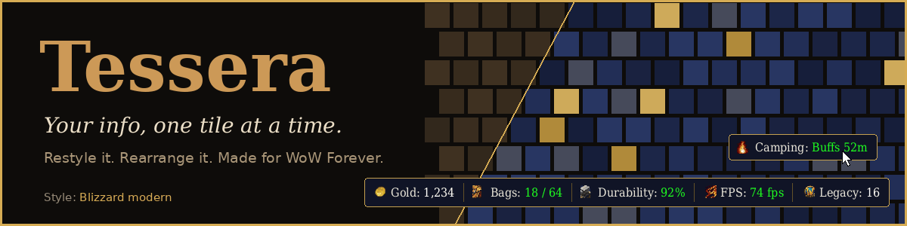
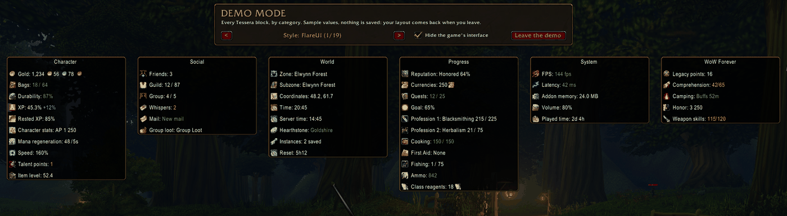
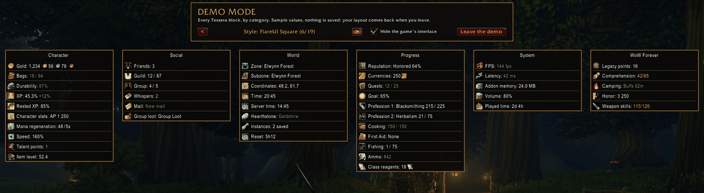
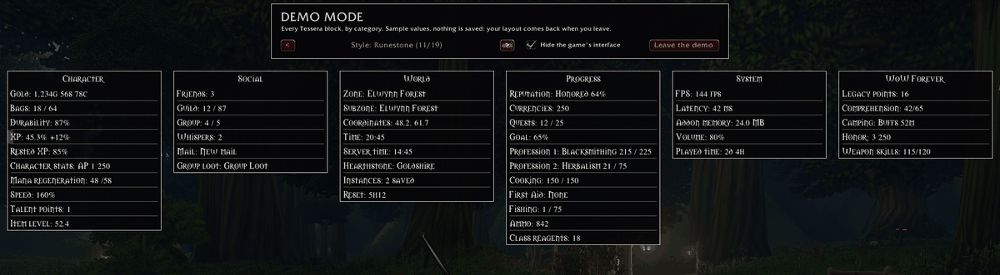
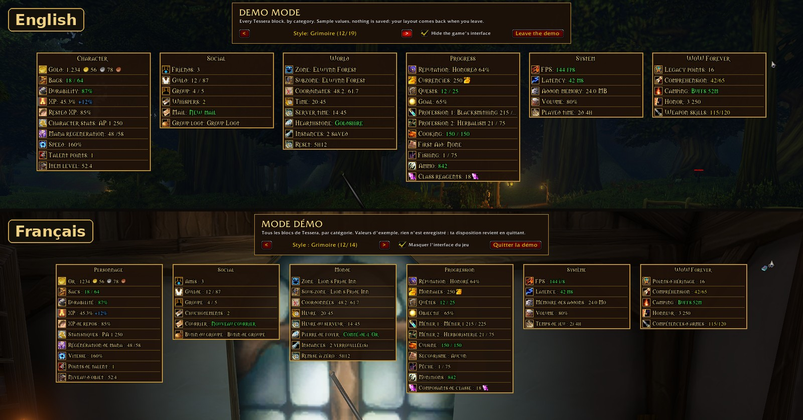

# Tessera – Mosaic Info Bars & Data Blocks



**Download:** [CurseForge](https://www.curseforge.com/wow/addons/tessera) · [Wago](https://addons.wago.io/addons/tessera) · [GitHub releases](https://github.com/Brainc3ll/Tessera/releases)

Tessera is a World of Warcraft addon for **WoW Forever** that shows small information blocks
(gold, bags, durability, FPS, latency, time, XP, quests...) and launcher blocks (minimap and
addon compartment buttons). Each block can be styled and placed on its own, and blocks placed
against each other **merge** into a single frame, like the tiles (*tesserae*) of a mosaic.

It only uses data provided by the game itself, and embeds no library. LibSharedMedia is used
when another addon provides it, to offer that addon's fonts, backgrounds and borders, and
LibDataBroker to exchange data with DataBroker addons.

> **Made for WoW Forever.** Tessera was developed and tested on WoW Forever. Its own systems
> (Legacy, camping, Comprehension, PvP) have no official addon documentation yet and may change;
> a block may then need an update.

## Screenshots

Demo mode (`/tessera demo`) shows every block at once with sample values. The same blocks in
the 19 styles (FlareUI is shown with the addon installed; without their addon, the interface
styles are an imitation):

**Interface and Blizzard styles**



**Square, Clean and Transparent styles**



**Fantasy styles and styles made from the game's frames**



**English and French built in**



## About this project: how Tessera is made

Tessera is a collaboration between me, a player, and an AI.

**Me (Braincell1980).** I don't write code. Life never gave me the chance to learn programming, and AI finally lets me give free rein to my addon ideas. It is not "one prompt and the AI does everything": I also use the AI to learn quickly how things work and why (GitHub, CurseForge, WoW's Lua and its interface, what a clean release looks like) so I can make the decisions myself and understand what is done. What I do:
- I had the idea of Tessera and I decide what it does: every feature, block, option and layout comes from my requests or was approved by me.
- I choose the look: styles, colors, layouts, names, what goes in the menus.
- I test a lot, on WoW Forever: every version, with strange experiments, unusual placements and odd setups, to find the problems before you do.
- I try to think ahead, for every kind of player: other interfaces, other screens, other languages, other habits.
- I run the in-game checks (debug versions) used to find out how WoW Forever works, and I report bugs with screenshots.
- I review the texts, the French translation and the help.
- I decide when a version is published, and I manage the CurseForge and GitHub pages.

**Claude (an AI by Anthropic)** writes everything else, from my instructions:
- all the code of the addon (Lua), and the automatic tests that run it outside the game;
- the English and French texts: options, tooltips, help, changelog, this page;
- the release tools (GitHub workflows, CurseForge upload) and the debug versions;
- the banner images.

**What this means for you.** The code is checked by automatic tests and by my many tests in game, but it has not been reviewed line by line by a human programmer. Bugs can remain: please report them with `/tessera bug`. Developers are welcome to read the code (MIT license, in this repository) and to suggest improvements.

## At a glance

- Interface: `16001` (WoW Forever)
- Languages: English, French (other languages can be added through CurseForge's localization tool)
- Saved variables: `TesseraDB`
- Optional addons it adapts to: FlareUI (default look and placement under its XP bar),
  EllesmereUI, ElvUI, LibSharedMedia-3.0, LibDBIcon-1.0, LibDataBroker-1.1 and DataBroker
  display addons (Titan Panel, ChocolateBar, Bazooka...)

## For players

Copy the `Tessera` folder into the `Interface/AddOns/` folder of your WoW Forever
installation (or let CurseForge do it). Type `/tessera` (or `/tes`) to open the options; the
Help tab inside the game explains everything.

**Highlights**

- **Mosaic placement:** blocks are placed anywhere and merge in every direction when dropped
  against each other: a bar, a column, a corner, an L shape... Bars can be stuck to a screen edge
  and stretched like a taskbar, and ready-made layouts give a starting point (among them "Double
  bar": the top bar and a second bar always shown with the WoW Forever blocks).
- **Demo mode:** every block at once, sorted by category, with sample values; a banner switches
  the styles (or shows them side by side, one per column: "Mixed styles") and hides the game's
  interface, for screenshots. Your layout comes back afterwards.
- **Blocks made for WoW Forever's own systems**, which can also be shared with DataBroker
  display addons (Titan Panel, ChocolateBar, Bazooka...):
  - Legacy points: your points, the next reward, every reward of the track and your Legacy
    challenges completed per category; a click opens the Legacy panel;
  - Comprehension: your scroll-reading skill and the scrolls in your bags; a click casts Scroll
    Comprehension;
  - Camping: time left on your camp buffs, or your campfire kit's cooldown; a click lights a
    campfire with the kit;
  - Honor: your honor points (PvP ranks in a later version);
  - weapon skills read from Forever's skill list; profession, talent and Legacy blocks that open
    Forever's own windows.
- More than 40 blocks in all: gold (with history and your characters' gold; Alt + right-click forgets a deleted character), bags (with junk value), durability (with the
  repair cost), FPS and latency (with graphs), local and server time, date, XP, rested XP, coordinates,
  zone and subzone, friends, guild, group, quests, reputation, currencies, professions (one block
  each, plus cooking, first aid and fishing), talent points, hearthstone, mail, whispers, class
  reagents, ammo, item level, speed, volume, addon memory, instances, played time, goal, mana
  regeneration, character stats (the stat of your choice), group loot (click: /roll)...
- Blocks that have nothing to show hide themselves (in a second row under the main bar).
- Merge blocks in every direction; undo, alignment guides, frozen groups, spacer blocks; groups
  fused, as tiles with joints, or separate.
- Replace a block in place: the arrows on a hovered block (placement mode) put another block
  exactly there, with the same look, without moving anything else; a shown block swaps places,
  and the spacers of the ready-made layouts can be filled this way. A cross hides the block.
- Per-block style, icons (same size, square or round frame, black and white), opacity, scale,
  progress bar, thresholds, show on hover, alerts, click actions, and how the value is shown
  (gold format, coin icons, rounding; bag slots; XP; durability; latency; seconds; decimals...).
- DataBroker tab: other addons' DataBroker objects as blocks ("Plugins as blocks"); Tessera's
  blocks shared with Titan Panel, ChocolateBar, Bazooka... ("Sharing and mode"); a DataBroker mode,
  on automatically when such an addon is installed (Tessera then shows nothing itself), that can
  be turned off to use both.
- Look tab: styles, how groups look, screen edges, ready-made layouts, blocks in front of or behind
  Blizzard's frames, and sharing, in one place, with shortcuts to the frame and text of all blocks.
- Round minimap button (click: options, right-click: lock / unlock, drag it around the minimap);
  with FlareUI, Tessera is in FlareUI's addon bag instead.
- 19 styles: matching FlareUI, ElvUI, EllesmereUI or Blizzard's look (also without that addon, as an
  imitation), Square styles, Clean, Transparent, fantasy styles (Runestone: text only, black and white; Grimoire;
  Parchment; Arcane) and styles made of the game's own frames (Royal Seal, Ironforge, Runeblade, Ember, Sylvan).
- Profiles with export/import, ready-made layouts and an automatic dungeon/raid profile; accessibility options.
- Share only a style or only a layout as text; the import lists what is missing on your computer
  (other addons' blocks, media, WoW Forever blocks) before applying anything.
- Tooltips your way: bigger or smaller, or only while holding Alt (General tab).
- A quick tour on first launch (again from the Help tab), where the ready-made layouts can be
  tried one after the other right on the screen, and a demo mode showing every block by category
  with sample values and a style switcher.
- In front of or behind Blizzard's frames: Tessera never moves them. When blocks cover some of them
  (action bars, minimap, buffs), you choose whether the blocks stay in front or behind; placement
  mode (and Blizzard's Edit Mode) can switch every block for a while to see what is underneath.

| Command | Effect |
|---|---|
| `/tessera` | Open or close the options |
| `/tessera lock`, `/tessera unlock` | Lock the blocks, or unlock them to move them |
| `/tessera reset` | Reset everything: empties the saved variables, then reloads the interface |
| `/tessera minimap` | Show or hide the minimap button |
| `/tessera preview` | Sample values in every block (for screenshots) |
| `/tessera demo` | Demo mode: every block by category, sample values, style switcher (again to leave) |
| `/tessera bug` | Report to copy into a bug report |
| `/tessera broker` | DataBroker mode on or off |
| `/tessera recover` | Bring back blocks that stick out of the screen |
| `/tessera help` | The list of commands in the chat |

Key bindings (show / hide all blocks, lock / unlock, options) are in the game's key bindings,
Tessera category.

When unlocked: drag a block to move it (or its whole group), drop it against another block to
merge them, **Shift + drag** to detach it, the **cross** on a hovered block (or **Ctrl + click**)
to hide it, its **arrows** to replace it with another block, **Ctrl + Z** to undo, **right-click**
for the quick menu; a panel under the placement banner shows what you can do with the hovered
block. When locked: hover for the tooltip, left-click to open
the related game window, **Shift + click** to copy the value to the chat, right-click for the
block's settings, **Alt + right-click** for the quick menu.

**Reporting a bug:** type `/tessera bug`, copy the report from the window that opens and paste it
into a new issue (a template is provided), or in the comments of the
[CurseForge page](https://www.curseforge.com/wow/addons/tessera).

## For developers

The code is plain Lua with no build step and no embedded libraries. Every file starts with a
header explaining its role, and the tricky parts (secure clicks, secret values, border seams)
are commented in place. Start with the headers of `Core.lua`, `Modules.lua` and `Merge.lua`.

### Files (in load order, see `Tessera.toc`)

| File | Role |
|---|---|
| `Locales/enUS.lua` | English strings: the base table `ns.L`. Every key must exist here. |
| `Locales/frFR.lua` | French strings, override `ns.L` keys when the game is in French. |
| `Core.lua` | Shared namespace, media lists, frame skinning, saved variables and profiles, block creation/styling/visibility/updates, mouse handlers, snapping, default layout, events, the shared update timer, slash commands, minimap button. |
| `Themes.lua` | The styles (FlareUI, EllesmereUI, ElvUI, Blizzard modern/classic, Square styles, Clean, Transparent, fantasy styles, styles made of the game's frames), the style offered when an interface is installed. |
| `Merge.lua` | Docking blocks into groups, group layout (sizes, equal heights/widths, shared widths, centering, second row), unlock-mode name tags, border seams and corner joins. |
| `Placement.lua` | Coordinates and scale, relative positions, undo, alignment guides, snapping to Blizzard frames, frozen groups, quick menu, click actions, key bindings. |
| `Layers.lua` | Blocks in front of or behind Blizzard's frames: which frames the blocks cover, the question when locking, the temporary switch of placement mode; Edit Mode copies left by older test versions (back to the player's layout, cleanup). |
| `Profiles.lua` | Profile export / import (text), style and layout sharing with the check of what is missing, duplicate, automatic dungeon / raid profile. |
| `SecureClicks.lua` | Invisible secure buttons over blocks, so clicks open Blizzard windows without tainting them. |
| `Changelog.lua` | Version history for the in-game About tab (Changelog topic), sorted by kind since 1.0.0 (new, improvements, fixes), in English and French only (not sent to CurseForge's translation tool) (`lua5.1 tools/changelog_md.lua > CHANGELOG.md` regenerates `CHANGELOG.md`). |
| `Modules.lua` | Definitions of all data blocks. **This is where you add a block.** |
| `Launchers.lua` | Launcher blocks built from minimap buttons, LibDBIcon buttons and addon compartment entries. |
| `Spacers.lua` | Spacer blocks (empty, separator line or text). |
| `Demo.lua` | Demo mode: every block by category with sample values, style switcher (also mixed styles, one per column), the player's profile put aside and given back. |
| `Broker.lua` | DataBroker: other addons' data objects as blocks, Tessera's blocks published as data objects, DataBroker mode. |
| `Bindings.xml` | Key bindings (loaded automatically by the game, not listed in the TOC). |
| `Options.lua` | Options window (tabs Blocks — with sub-tabs Display, Text, Frame, Behaviour —, Look, General, Launchers, DataBroker — Plugins as blocks, Sharing and mode —, Profiles, Help, About), widgets, placement banner, text window (export / import / bug report), welcome popup and quick tour, Blizzard Settings page. |

The `docs/` folder (not shipped in the addon) holds the release guide (`docs/RELEASE.md`), the
CurseForge and Wago descriptions, the strings sent to CurseForge's localization tool, the project
status and ideas (in French), finished plans (`docs/archive`), the logo in large sizes (`docs/art`), and the banner and screenshots used on this page (`docs/media`). `CLAUDE.md` holds
the working rules of the project.

Automatic tests: `lua5.1 tools/mock_run.lua . enUS` (or `frFR`, `frFR broker`) loads the addon
with a small imitation of the game API and runs every page and feature; lint with `luacheck .`;
`lua5.1 tools/fuzz_blocks.lua .` checks that the blocks built on WoW Forever's own systems survive
missing or changed game functions; `lua5.1 tools/check_docs.lua .` checks that the documentation
follows the code; `tools/api_audit.py` audits the code against the WoW API like addon reviewers
do. All of them run on every push (`.github/workflows/checks.yml`).

### How a value gets on screen

1. `Modules.lua` registers each block with `ns:RegisterModule(key, def)`.
2. At login, `Core.lua` loads the profile from `TesseraDB`, creates one frame per block and
   applies its style (`ns:ApplyStyle`), position and docking (`Merge.lua`).
3. A block is refreshed by `ns:UpdateBlock(key)` when one of its `events` fires, or by the
   shared timer every `interval` seconds while it is shown.
4. `UpdateBlock` calls the module's `update(cfg)`, which returns a text and an optional level
   (1 good, 2 warning, 3 bad). Core colors it, adds the label and icon if enabled, and asks
   for a layout pass when the text size changes.
5. The layout pass (`ns:UpdateLayout` in `Merge.lua`) sizes every block to its text, equalizes
   merged groups, centers anchored groups and redraws the borders where blocks touch.

### Adding a data block

Open `Modules.lua`: its header documents every field a block can define, with a minimal
example. In short:

```lua
ns:RegisterModule("level", {
    label = "LEVEL",                          -- display name = L.LEVEL
    icon = "Interface\\Icons\\INV_Misc_Note_01",
    events = { "PLAYER_LEVEL_UP" },           -- or interval = seconds
    defaultEnabled = false,                   -- hidden until the player enables it
    update = function(cfg)
        return tostring(UnitLevel("player")), 1
    end,
    tooltip = function(tt, cfg)
        tt:AddLine("Some detail", 1, 1, 1)
    end,
})
```

Then add `LEVEL = "Level"` to `Locales/enUS.lua` and `L.LEVEL = "Niveau"` to
`Locales/frFR.lua`. Never rename a block key once released: it is stored in players' saved
variables. The block appears automatically in the options.

To open a Blizzard window on click, use `secureMacro` (a macro run by a secure button) rather
than calling the function from Lua: on this client, opening UI panels from addon code taints
them.

### DataBroker

`Broker.lua` explains it in its header. In short: blocks under keys `broker:<object name>` show
another addon's data object (looked up by name each time, so a disabled addon only hides the
block); every data block with `brokerShare` is published as `Tessera_<block key>` while sharing
is on; DataBroker mode (`ns.brokerModeActive`) hides all of Tessera's frames. A module needs
nothing special to be shared: its `update`, `tooltip` and `onClick` are reused. Blocks that open
Blizzard windows through `secureMacro` cannot do so from another addon's bar.

### WoW Forever specifics

- **Character names:** WoW Forever names characters "First name Surname", unique in the whole
  region (`RegionalUniqueNamesEnabled`, read through `_G`). Tessera keys a character's saved data
  (gold, per-character profile) by that full name, as AceDB does (`ns.CharacterKey`), and moves
  data saved under the older "Name-Realm" key once (`ns:MigrateCharacterKey`).

WoW Forever runs on the modern client (Midnight-era API) but has systems of its own, without
public documentation yet. What Tessera found, with the development probes below:

- **Legacy points** (`legacy` block, `Modules.lua`): the "Legacy" reward track is a renown track
  of Blizzard's major factions system, faction ID `2802`. The points are
  `C_MajorFactions.GetMajorFactionData(2802).renownLevel`; the reward levels come from
  `C_MajorFactions.GetRenownLevels(2802)` and each reward from
  `C_MajorFactions.GetRenownRewardsForLevel(2802, level)` (its `name`, else its
  `toastDescription`, else the item's name). Updated on `MAJOR_FACTION_RENOWN_LEVEL_CHANGED`
  and every minute. The block is registered only when `ToggleLegacySystemUI` (or
  `LegacySystemFrame_LoadUI`) exists. **Legacy challenges are achievements**: the achievement
  categories are the challenge categories (Classes, Crafting, PvP, Dungeons, Raids, Adventure,
  with sub-categories); the tooltip adds up `GetCategoryNumAchievements` per main category
  (parent `-1`). Not found yet as an API: the unspent points of the Legacy tree and the
  "Legacy points: 16/81" total, which only exist as texts of the Legacy panel
  (`ChallengesPage.LegacyChallengePointSummary.PointsBar`, `TreePage.LegacyTreePointSummary`).
- **Comprehension** (`comprehension` block): a secondary skill, `skillID` `3012` in
  `C_SkillInfo` (category `9`, learned from level 6); its spell is `1296017`. Scrolls in the
  bags are consumables of subclass `4`, or items whose name holds the localized word "scroll"
  (weapon imbue scrolls are item enhancements).
- **Camping** (`camping` block): camp buffs are player auras: `1229741` (camp perks, 1 hour),
  `1229739` (welcoming campfire: sit 1 minute to get the buffs) and `1283391` (nearby
  campfire). The basic campfire kit is item `279981`; its cooldown comes from
  `C_Container.GetItemCooldown`, and the block's click is `/use item:279981`.
- **Honor** (`honor` block): currency `1792` in `C_CurrencyInfo.GetCurrencyInfo` (25,000 max).
  The classic rank functions (`UnitPVPRank`, `GetPVPRankInfo`) do not exist; the new rank system
  still has to be found once characters can earn ranks.
- **Weapon skills** (`weaponSkills` block): the classic globals `GetNumSkillLines` /
  `GetSkillLineInfo` do not exist; `C_SkillInfo.GetNumSkillLines()` and
  `C_SkillInfo.GetSkillLineInfo(i)` do, and return one table per line (`name`, `rank`,
  `maxRank`, `isHeader`, `isAbandonable`, `skillLineCategoryID`, `skillID`). Weapon skills are the
  lines of category `6` (defense, `skillID` 95, is listed with them). The skills window is
  `SkillsFrame`, a tab of the character window.
- **Opening windows**: Forever has micro buttons that retail removed or merged:
  `ProfessionMicroButton` (professions book, used for gathering professions, which have no
  crafting window), `TalentMicroButton`, `LegacyMicroButton`, `SpellbookMicroButton`. Blocks
  click them with a `/click` macro on their secure overlay (`MicroButtonMacro` in
  `Modules.lua`), so the panels open from Blizzard's own code, without taint.
- All IDs above were found on the beta (October 2026) and may change.
- **Development probes** live in the test builds only (see "Test builds" below): they list
  what the client offers (API namespaces and functions, the Legacy panel's fields and texts,
  the raw skill list) in a window that can be copied, to adapt a block when Forever changes.

### WoW-specific constraints to keep in mind

- **Taint and secret values.** This client uses the Midnight-era API, where some values are
  "secret" and comparing them from addon code raises an error. Values that may be secret are
  read inside `pcall`. Blizzard panels are opened through secure macro buttons
  (`SecureClicks.lua`).
- **Combat lockdown.** Secure buttons cannot be created, moved or hidden in combat; they are
  positioned in screen coordinates and re-synced after combat.
- **Forever-only functions.** The code uses the modern `C_*` API of this client. Functions that
  only exist on WoW Forever, and other addons' globals, are read through `_G["Name"]` and called
  in `pcall`: if the game removes or changes one, the block shows nothing instead of an error
  (`tools/fuzz_blocks.lua` checks it).

### Saved variables

`TesseraDB` holds the profiles (`profiles[name]`, see `PROFILE_DEFAULTS` in `Core.lua`), the
profile mode (`useGlobal`, `globalProfile`, `charProfiles`), each character's gold (`chars`),
and a few account-wide options. Each profile stores its general settings and one table per
block in `blocks[key]` (see `BLOCK_DEFAULTS` in `Core.lua`).

### Translations

`Locales/enUS.lua` defines every key; every other language only overrides keys and falls
back to English for anything missing.

- English and French are written in the repository (`enUS.lua`, `frFR.lua`).
- Every other language is translated by the community with CurseForge's localization tool.
  Its file (e.g. `Locales/deDE.lua`) only holds a `--@localization(...)@` line that the
  BigWigs packager replaces with the translated strings when it builds the release zip, so
  a copy installed straight from GitHub simply shows those languages in English.
- **Small keys, easy to translate.** On CurseForge, changing a text asks every translator to
  redo that whole text. So long texts are split: the in-game help has one key per line or
  paragraph (`HELP_<TOPIC>_<n>`, topic titles `HELP_T_<TOPIC>`), and their order is given by
  `ns.HELP_LAYOUT` / `ns.HELP_LAYOUT_BROKER` at the end of `Locales/enUS.lua`. To add a line,
  create a **new** key (next free number of its topic) and put it where it belongs in the layout;
  to change a line, keep its key. Never renumber, rename or reuse a key (this also goes for the
  numbered quick tour steps, `TUTORIAL_<n>`). `tools/check_docs.lua` refuses any text longer
  than 600 characters.
- `docs/localization/` holds the English and French strings in the format CurseForge imports
  (regenerate with `lua5.1 tools/export_locales.lua . enUS docs/localization/enUS.lua`, same
  for `frFR`). The release workflow sends both to CurseForge before packaging, so translators
  always see the current strings; nothing has to be imported by hand.

### Releasing

One workflow publishes everywhere: **Package and release** (`.github/workflows/release.yml`,
"Run workflow" in the Actions tab). It checks the documentation, tags the version written in
`Tessera.toc`, sends the strings to CurseForge, builds the zip with the BigWigs packager and
uploads it to GitHub, CurseForge and Wago. Details (in French) in `docs/RELEASE.md`.

### Checking your changes

```sh
luacheck .                       # static checks (uses the provided .luacheckrc)
lua5.1 tools/mock_run.lua .      # loads the addon in a rough WoW API mock, prints Lua errors
lua5.1 tools/fuzz_blocks.lua .   # WoW Forever's blocks survive missing or changed game functions
lua5.1 tools/check_docs.lua .    # README, help, descriptions, changelog, strings: up to date?
python3 tools/api_audit.py <lua-language-server> <vscode-wow-api folder>
```

`tools/api_audit.py` runs the audit addon reviewers use: the Lua Language Server with Ketho's
WoW API annotations ([vscode-wow-api](https://github.com/Ketho/vscode-wow-api)). It fails on
unknown globals and deprecated functions. Functions that only exist on WoW Forever (not in
Blizzard's documentation of the modern API) and other addons' globals are read through
`_G["Name"]`, which tells readers they may be missing.

`tools/check_docs.lua` checks that the version is the same everywhere, that `CHANGELOG.md` and
`docs/localization/` match the code, and that every public command, block, Lua file and option
tab appears in the README, the in-game help and the CurseForge / Wago descriptions. A release
stops if it fails.

The mock only catches Lua errors (nil calls, typos, load order); it does not replace testing
in game.

### Test builds

Released versions have no command a player does not need. The test builds given to the
author for his test sessions add one extra file (`TesseraDev.lua`, kept out of this repository
and never packaged) at the end of `Tessera.toc`: `/tessera test` (blocks to check, layouts for
the name tags, tooltip settings, back to the player's profile) and the development commands
(debug report, WoW Forever probes, shape test). `Core.lua` only calls
`ns.DevCommand` when that file is there; the mock loads it with `TESSERA_DEV=<path>`.

## License

MIT — see `LICENSE`.
